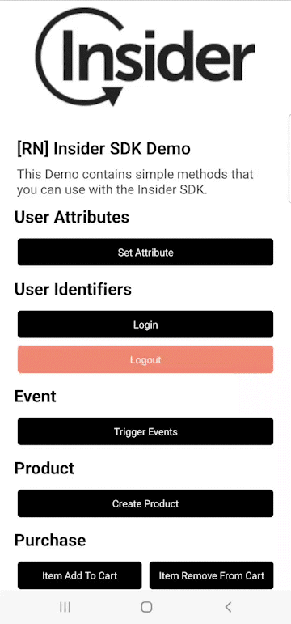

# Insider Ionic Demo

  
  
  <table align="center">
    <tr>
      <td><a href="https://useinsider.com/"> Insider </a></td>
      <td><a href="https://www.npmjs.com/package/cordova-plugin-insider"> NPM JS rcordova-plugin-insider </a></td>
      <td><a href="https://academy.useinsider.com/docs/cordova-integration"> InsiderAcademy </a></td>
    </tr>
  </table>

  

## Description

This Demo contains simple methods that you can use with the Insider SDK.

## Preview

<table align="center">
  <tbody>
    <tr>
      <td></td>
    </tr>
  </tbody>
</table>

## Installation

Install all npm packages by running the `npm install` command in the home directory.

Replace partner name and app group value in `src/app/home/home.page.ts` with your info.

Note: Can easily find the warnings added as comments by searching the `FIXME-INSIDER` key in the project and you can quickly make the necessary arrangements for the project.

### Android

1. Add `google-services.json` and `agconnect-services.json` to `android/app` folder.
2. Add your keystore file to `android/app` folder and replace `signingConfigs` attributes in `android/app/build.gradle` file with your info.
3. Replace manifestPlaceholders -> partner value with your partner name in `android/app/build.gradle` file. (This step is important to add test device with QR or Email in the panel.)
4. And sync project with `ionic capacitor build android` command.
5. Run project with Android Studio.

### iOS

1. Sync project with `ionic capacitor build ios` command.
2. Open XCode and check the app group and bundle identifier for all targets.
3. Replace `insider` URL type in main target Info -> URL Types with your partner name. (This step is important to add test device with QR or Email in the panel.)
4. Change APP_GROUP variables value in `InsiderNotificationService/NotificationService.m` and `InsiderNotificationContent/NotificationViewController.m` files.
5. Run project with XCode.